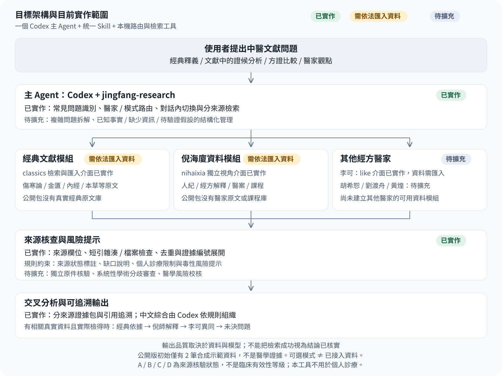

# 經方多醫家文獻研習 Skill

[简体中文](README.md) | **繁體中文**

`jingfang-research` · `0.2.0-public-preview` · Python 3.9+

一個統一入口，自動選擇倪海廈、李可或多醫家視角，檢索使用者的本機文獻，並追溯來源。支援常見中文問題路由、對話內切換、SQLite 中文檢索和證據展開。

**公開版僅附帶兩筆合成示範資料，不附帶經典原文、倪海廈／李可語料、醫案或課程。**未匯入有權使用的文獻時，醫學問題會明確提示資料不足。示範資料不能作為醫學證據。本專案是文獻研習工具，不是個人診療系統。

## 目標架構與目前實作範圍



**已實作**表示已有工具或介面；**需依法匯入資料**表示公開包不附帶對應文獻；**待擴充**表示尚未實作或尚未建立可用模組。這些是實作範圍，不是醫學證據或臨床有效性等級。

| 架構部分 | 目前狀態與限制 |
|---|---|
| 統一入口與知識路由 | **已實作**常見問題、醫家和模式識別、對話內切換、分來源檢索；複雜問題拆解及事實／缺少資訊／假設的結構化管理**待擴充** |
| 經典文獻模組 | classics 檢索和匯入介面**已實作**；《傷寒論》《金匱要略》《內經》《本草》等真實原文**需依法匯入資料**，公開包只有兩筆合成示例 |
| 倪海廈資料模組 | nihaixia 獨立視角介面**已實作**；課程、醫案、經方解釋等**需依法匯入資料**，不能聲稱已附帶倪師知識庫 |
| 其他經方醫家 | 李可 like 介面**已實作**，真實資料**需依法匯入**；胡希恕、劉渡舟、黃煌等的路由和資料模組**待擴充**，不只是缺少幾個檔案 |
| 來源核查與風險提示 | 來源欄位、短引雜湊與本機檔案檢查、去重、證據編號展開**已實作**；來源狀態、診療限制及風險提示由規則約束。獨立原件核驗、系統性學術分歧審查和醫學風險校核**待擴充** |
| 交叉分析與可追溯輸出 | 分來源證據包與引用追溯**已實作**；只有相關真實資料已匯入並檢得時，才可比較經典依據、醫家解釋、異同與未決問題。中文綜合由 Codex 依規則生成，仍需審查 |

這是一個 Codex 主 Agent 呼叫統一 Skill 與 Python 工具的實作，圖中模組不是多個獨立 Agent。**可選模式不等於已接入資料；檢索、雜湊或測試通過不等於原文、學術結論或醫學安全性已經核實。** 文獻中的證候分析不轉化為真實患者的個人治療指令。

## 直接使用整個儲存庫

下載或複製本儲存庫後進入目錄，執行：

```bash
python3 .agents/skills/jingfang-research/scripts/build_index.py
python3 .agents/skills/jingfang-research/scripts/research.py '桂枝汤和麻黄汤有什么区别？'
python3 .agents/skills/jingfang-research/scripts/research.py '展开证据 DEMO001'
```

上述 CLI 查詢保留已驗證的簡體輸入。繁體 README 不代表程式已具備完整繁簡路由支援；繁簡映射的限制見下文。

接著在 Codex 中開啟本儲存庫，啟動新對話，直接說：

- 「倪師怎麼看桂枝湯？」
- 「切換李可視角。」
- 「比較倪海廈和李可的觀點；缺少資料的地方明確說明。」

本儲存庫的 AGENTS.md 引導統一入口；也可用 `$jingfang-research` 明確呼叫。Skill 發生變更而未顯示時，重新開啟專案或新對話。官方載入規則見 [Codex Skills](https://learn.chatgpt.com/docs/build-skills)。

## 安裝到另一個專案

在本儲存庫執行，明確指定一個已存在的目標專案：

```bash
python3 scripts/install_skill.py --project /path/to/your-project
```

安裝程式只複製公開清單中的自包含 Skill，並為目標獨立建立示範索引。不寫入全域 Codex 設定，不修改目標 AGENTS.md；遇到同名 Skill 會拒絕覆寫。目標專案若已有同名本機研習版，請繼續保留該版本，在新的測試專案試用公開版。

在目標專案啟動新對話。自然語言選擇取決於 Codex 實際互動；必要時用 `$jingfang-research`。可以自行將「涉及經方文獻研究時優先使用 jingfang-research，工程任務正常處理」加入目標專案說明，但安裝程式不會擅自修改它。

解除安裝時只移除目標專案的 `.agents/skills/jingfang-research`；請先備份其中自行匯入的資料和對話狀態。沒有背景程序、服務或連接埠需要停止。

## 匯入自己的文獻

依照[授權資料匯入說明（簡體中文）](docs/DATA_IMPORT.md)準備資料包，在實際安裝位置執行：

```bash
python3 .agents/skills/jingfang-research/scripts/import_evidence.py /path/to/authorized-bundle --name my-source
```

匯入程式只讀取本機 JSONL 和必要來源檔案，不下載資料、不執行資料包內的腳本。使用者資料存入 `modules/private-*`，不會加入公開檔案清單，Git 預設忽略。RIGHTS.md 與 rights_basis 只是使用權聲明，工具不會獨立核實授權。

經典、倪海廈和李可的資料分別標記 perspective。沒有相應紀錄時不生成其觀點。真實證據 ID 由匯入資料決定；公開版不包含 N003，示範 ID 是 DEMO001／DEMO002。

## 模式與對話

當前明確的多醫家／比較指令優先，否則依序為：當前選擇 > 本對話最近明確模式 > 提及的醫家 > 預設多醫家。新對話預設 comparison。程式的詞法路由涵蓋常見表達，複雜問題仍需要 Codex 正確理解。

CLI 可用 `--mode nihaixia` / `like` / `comparison` 表示前一模式；當前指令可覆寫。使用 `--interactive` 時產生獨立對話，輸入 `exit` 離開。只有明確指定 `--session` 或使用互動模式才會儲存最近問題和模式；請勿輸入患者身分資訊，不同對話不要共用 ID。

## 相依項目和檢索限制

使用 Python 3.9+ 標準函式庫，無須 pip、付費 API、Docker、向量資料庫或 Web 服務。SQLite 支援 FTS5 trigram 時使用三字檢索，否則改用字面掃描；兩字查詢改用字面比對。繁簡映射有限，不是完整的中文斷詞或語意檢索。

執行路徑從腳本自身定位，不依賴固定使用者名稱或工作目錄；整個 Skill 可以搬移。CLI 輸出證據包，中文分析由 Codex 組織。腳本可離線使用，不代表 Codex 模型可離線使用。

A／B／C／D 是原件核驗、待核定位、第三方整理、AI 推論／示範等來源狀態，不是臨床有效性等級。即使找到原話，也不等於相關療效和安全性已獲證實。

## 測試與產生發布包

```bash
python3 -B -m unittest discover -s tests -v
python3 scripts/package_release.py --output ../jingfang-research-public.zip
```

打包程式核對 PUBLIC_FILES.json 中的檔案與雜湊值，只打包這些文字檔案。未知檔案、內容變更或疑似個人資訊會使檢查失敗；不會自動把新資料加入清單。產生的索引、對話狀態與快取不進入 ZIP；存在未列入清單的私人資料時會拒絕打包。不要直接壓縮整個本機研習目錄。

修改公開程式碼後，維護者須審查變更和隱私，再更新清單中的雜湊值。發布腳本只負責本機打包，不會自動上傳或設定 GitHub。測試範圍與待驗項目見[測試報告（簡體中文）](docs/TEST_REPORT.md)。

## 授權條款

本公開包的原創程式碼、文件和合成示範資料採用 [MIT](LICENSE)。不包含第三方醫學語料或上游程式碼；使用者匯入的資料不會自動取得 MIT 授權。[公開包範圍與授權說明（簡體中文）](docs/DISTRIBUTION.md)。
